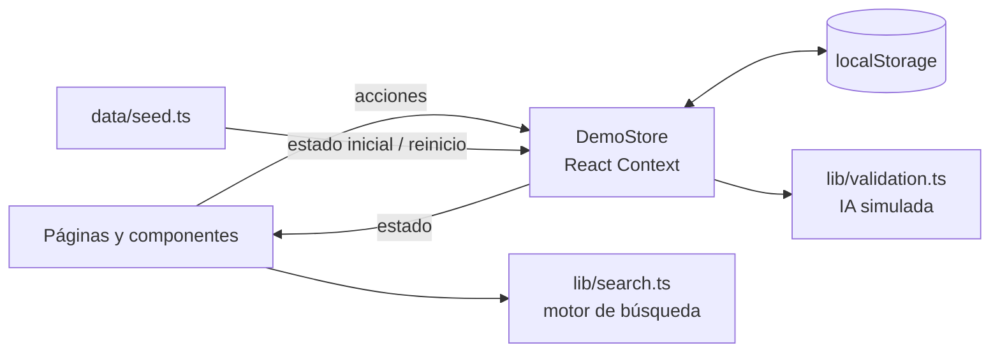

# DocuGestión · Demo de Gestión Documental Inteligente

Demo 100 % frontend de una plataforma de gestión documental con clasificación, validación y búsqueda asistidas por IA. Todo corre en el navegador, sin backend: los datos se guardan en `localStorage` y la IA está simulada con reglas deterministas.

**Demo online:** https://danidiazmenendez.github.io/gestion-documental-demo/
## 1. Qué representa la demo

La demo muestra el circuito completo de un documento dentro de una organización:

1. **Carga**: el usuario sube un archivo (PDF, Word, Excel, imagen o texto). El sistema lo clasifica, extrae campos clave, sugiere etiquetas y genera un resumen.
2. **Validación**: un motor de reglas revisa el formato, el tamaño, los metadatos obligatorios, los duplicados, los datos sensibles, la vigencia y la confianza de la extracción, y asigna un puntaje.
3. **Revisión y aprobación**: los documentos recorren el ciclo de estados *Borrador → En revisión → Aprobado / Rechazado → Archivado*, con comentarios y motivos de rechazo.
4. **Búsqueda inteligente**: es una búsqueda en lenguaje natural que interpreta el tipo y el estado del documento, tolera acentos y variaciones de palabras, marca las coincidencias y ordena los resultados por relevancia.
5. **Auditoría**: guarda la trazabilidad de cada acción (quién, qué, cuándo y con qué resultado) y permite filtrarla y exportarla.

### Pantallas

| Ruta | Pantalla | Funcionalidades |
|------|----------|-----------------|
| `/` | Panel general | KPIs navegables, carga de los últimos 14 días, distribución por estado y tipo, pendientes y actividad reciente |
| `/documentos` | Documentos | Pestañas por estado; filtros por tipo, área y confidencialidad; búsqueda; orden; paginación; selección múltiple; cambio masivo de estado; exportación CSV; panel de detalle |
| `/cargar` | Cargar documento | Arrastrar y soltar o elegir un archivo, clasificación automática, formulario editable, etiquetas, validación paso a paso y registro |
| `/validacion` | Validación | Cola de revisión, filtros, validación individual o masiva con progreso, aprobación y rechazo con motivo |
| `/busqueda` | Búsqueda inteligente | Búsquedas sugeridas y recientes, facetas, interpretación de la consulta, fragmentos resaltados y relevancia |
| `/auditoria` | Auditoría | Filtros por texto, usuario, acción, resultado y fechas, rangos rápidos, KPIs, generación de actividad simulada y exportación CSV |
| `/arquitectura` | Arquitectura | Mapa de componentes en 4 capas con vista *Demo actual* / *Implementación en Azure*, recorrido animado paso a paso de cada acción de la pantalla (carga, validación, cambio de estado, búsqueda, consulta y auditoría), y actividad registrada vinculada a cada recorrido |

Arriba a la derecha se ven el badge **DEMO** y el botón **Reiniciar demo**, que devuelve `localStorage` a los datos iniciales.

## 2. Arquitectura del proyecto

- **Stack**: Vite 5, React 18, TypeScript 5 (modo estricto) y React Router 6. Los estilos están en CSS plano y los íconos son SVG propios, sin librerías de UI.

```
├── index.html
├── package.json
├── tsconfig.json
├── vite.config.ts
├── public/
│   └── favicon.svg
└── src/
    ├── main.tsx                  # Punto de entrada: Router + proveedores
    ├── App.tsx                   # Definición de rutas
    ├── styles.css                # Sistema visual completo
    ├── types.ts                  # Modelo de dominio (documentos, validación, actividad)
    ├── data/
    │   └── seed.ts               # Datos iniciales deterministas (documentos + auditoría)
    ├── lib/
    │   ├── utils.ts              # Formateo, normalización de texto, CSV, descargas
    │   ├── validation.ts         # Clasificación, extracción y motor de validación simulados
    │   └── search.ts             # Interpretación de la consulta, ranking y fragmentos
    ├── store/
    │   └── DemoStore.tsx         # Estado global (Context) persistido en localStorage
    ├── components/
    │   ├── Layout.tsx            # Sidebar, topbar, búsqueda global, DEMO y reinicio
    │   ├── DocumentDetailPanel.tsx  # Panel lateral: resumen, datos, validación, historial
    │   ├── ValidationChecks.tsx  # Resultado de los controles de validación
    │   ├── ActivityItem.tsx      # Ítem de actividad
    │   ├── Badges.tsx            # Estado, confidencialidad, puntaje, tipo de archivo
    │   ├── Modal.tsx             # Diálogo modal
    │   ├── Toast.tsx             # Notificaciones
    │   └── Icon.tsx              # Íconos SVG
    └── pages/
        ├── DashboardPage.tsx
        ├── DocumentsPage.tsx
        ├── UploadPage.tsx
        ├── ValidationPage.tsx
        ├── SearchPage.tsx
        ├── AuditPage.tsx
        ├── ArchitecturePage.tsx  # Mapa de componentes y recorridos demo → Azure
        └── NotFoundPage.tsx
```

### Flujo de datos



- `DemoStore` es la única fuente de verdad. Expone acciones (`addDocument`, `changeStatus`, `runValidation`, `addComment`, `logActivity`, `recordSearch`, `generateActivity`, `resetDemo`), y cada acción registra su evento de auditoría.
- La URL guarda el estado navegable: filtros (`?estado=`, `?tipo=`), la consulta (`?q=`) y el documento abierto (`?id=`). Así se pueden compartir enlaces y usar el botón Atrás.

## 3. Cómo instalar

Requisitos: **Node.js 18 o superior** y npm.

```bash
npm install
```

## 4. Cómo ejecutar localmente

```bash
npm run dev
```

Abrí **http://localhost:5173** en el navegador.

Otros scripts:

| Comando | Descripción |
|---------|-------------|
| `npm run build` | Chequeo de tipos (`tsc`) y build de producción en `dist/` |
| `npm run preview` | Sirve el build de producción localmente |

### Deploy en GitHub Pages

Cada push a `main` dispara el workflow `.github/workflows/deploy.yml`. El workflow compila con `BASE_PATH=/<nombre-del-repo>/` y copia `index.html` como `404.html` para que funcionen las rutas profundas de la SPA. Después publica `dist/` en GitHub Pages.

Demo publicada: **https://danidiazmenendez.github.io/gestion-documental-demo/**

## 5. Qué elementos son simulados

| Elemento | Cómo se simula |
|----------|----------------|
| Backend y base de datos | Estado en memoria persistido en `localStorage` (clave `gestion-documental-demo:state`) |
| Almacenamiento de archivos | El archivo se lee en el navegador: se toma el texto de `.txt`, `.csv` y `.md` y se previsualizan las imágenes. Ningún archivo sale del equipo |
| OCR y extracción de campos | Reglas y expresiones regulares sobre el nombre y el contenido del archivo, con valores de confianza calculados de forma determinista |
| Clasificación por IA | Palabras clave por tipo documental, con un porcentaje de confianza |
| Resumen y etiquetas | Plantillas según el tipo y el área |
| Motor de validación | Reglas locales (formato, tamaño, metadatos, duplicados, datos sensibles, vigencia, confianza) con demoras para simular el procesamiento |
| Búsqueda semántica | Normalización, raíces de palabras, sinónimos de tipo y estado, y puntaje ponderado por campo |
| Usuarios y autenticación | Usuario fijo (María González, Analista documental); el resto de los usuarios son ficticios |
| Actividad de otros usuarios | El botón "Generar actividad simulada" crea eventos aleatorios plausibles |
| Datos iniciales | Documentos y eventos de auditoría generados en `src/data/seed.ts` |

## 6. Servicios Azure para una implementación real

| Componente de la demo | Servicio Azure |
|-----------------------|----------------|
| Hosting del frontend | **Azure Static Web Apps** (o App Service) |
| API / backend (`DemoStore`) | **Azure Functions** o **Azure Container Apps**, publicados detrás de **Azure API Management** |
| Almacenamiento de archivos | **Azure Blob Storage**, con niveles Hot/Cool/Archive para el estado *Archivado* |
| Metadatos de documentos | **Azure Cosmos DB** o **Azure SQL Database** |
| OCR y extracción de campos | **Azure AI Document Intelligence** (modelos prediseñados y personalizados) |
| Clasificación de documentos | **Azure AI Document Intelligence** (clasificador personalizado) o **Azure OpenAI** |
| Resúmenes y etiquetas sugeridas | **Azure OpenAI Service** |
| Detección de datos sensibles | **Azure AI Language** (detección de PII) y **Microsoft Purview** (etiquetas de confidencialidad) |
| Búsqueda inteligente | **Azure AI Search** (búsqueda híbrida y vectorial, ranking semántico) |
| Flujo de validación y aprobación | **Azure Logic Apps** o **Durable Functions**, con eventos de **Azure Event Grid** |
| Autenticación y roles | **Microsoft Entra ID** (SSO y RBAC por área) |
| Auditoría y trazabilidad | **Azure Monitor** y **Log Analytics**; retención a largo plazo en Blob Storage inmutable |
| Secretos y claves | **Azure Key Vault** |
| Notificaciones | **Azure Communication Services** o Microsoft Teams vía Logic Apps |
